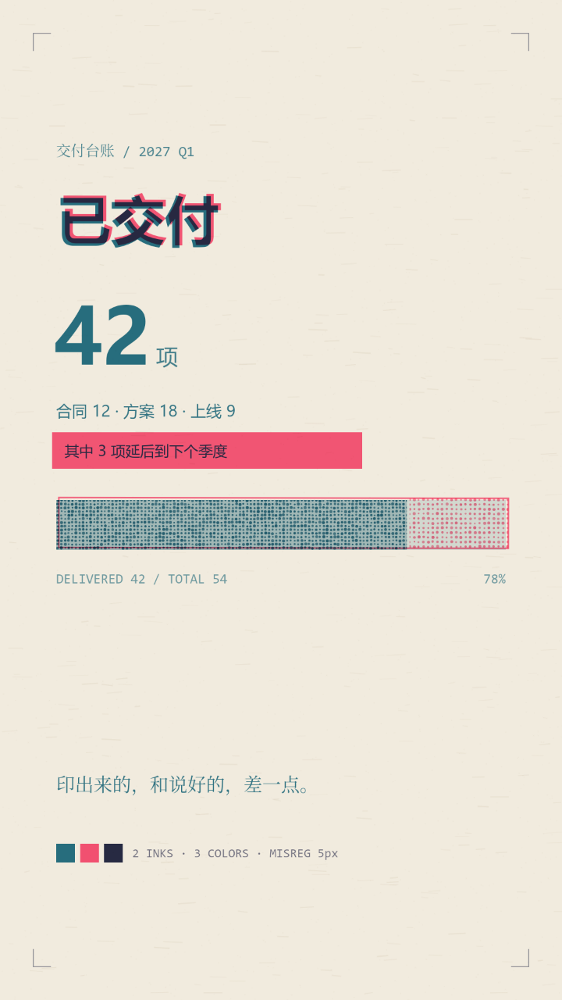

# 案例 07 · 丝网印刷

**状态：实验（单帧已验证，未出片）。** 没有分镜、没有旁白、没有成片，只验证了一件事：**两块色版套印能不能一眼认出来。** 实现就在本仓库：`renderer/exp/styles.js` 的 `riso()`，出一帧跑 `scripts/exp-render.mjs`。



## 一句话

两块色版，一种青一种荧光粉，中间隔着 5px 的错版——**说好的一版，和印出来的一版，永远差一点。**

## 视觉构成

| 项 | 值 |
|---|---|
| 纸 | `#F1EBDE` 暖米色再生纸；纤维 420 根（8–38px，alpha 0.12–0.32，线宽 0.8–2.4），杂点 2200 个（1.7px，alpha 0.07–0.21） |
| 版一（青） | `#1E6F8A` — 所有"说好的一版"的结构：标题、数字、正文、进度条、说明 |
| 版二（粉） | `#FF4E7A` 荧光粉 — 标题的第二遍、粉底色块、进度条外框与未完成段的网点 |
| 第三色 | `#1E2242` — **不是独立油墨**，是青 × 粉相乘的结果（`multiply`）。叠印处比任何单版都深 |
| 错版量 | 整体偏移 `(x+5, y−4)`，另加 0.0016rad（0.09°）旋转——第二块版压上去时手会歪 |
| 网点 | 间距 7px、点径 2.3×(0.7–1.3) 随机抖、位置抖 ±0.7px；**只撒在色块内**，纸面空处不上墨 |
| 进度条 | x 108–972、y 960–1056；青版网点覆盖 78%，剩下 22% 只有粉版网点 |
| 套准标记 | 四角 34px 直角，`#1E2242` alpha 0.55，只画在版一的位置 |
| 色标条 | 三个方块：青 / 粉 / 深靛，标签 `2 INKS · 3 COLORS · MISREG 5px` |
| 版式 | 眉标 y300、标题 y462（104px）、大数字 y700（150px）、正文 y800、粉块 y830–900、条 y960、说明 y1120、论点句 y1520、色标 y1620 |
| 单帧成本 | 87ms（1080×1920，含 PNG 编码）→ 1800 帧约 157 秒 |

## 实现入口

- `renderer/exp/styles.js` 的 `riso(c, p)`，`p` 是 0–1 的时间进度（当前只有 `t=1` 的静态帧）
- 出图：`scripts/exp-render.mjs --style riso --w 720 --out docs/samples/style-07-riso.png`
- 画法：`risoPaper`（纸）/ `risoDots`（网点，带种子）/ 两遍 `fillText`（版一、版二）/ `strokeRect`（条框）
- 全局开关：整段包在 `globalCompositeOperation = 'multiply'` 里——这是全仓库唯一用混合模式的地方，理由见下面第一条
- 色板导出在 `window.Exp.PAL.RISO`

## 关键技术点

**一、叠印是减色相乘，不是"压一层半透明"。** 第一版的做法是：青画一遍，粉画一遍，然后在两版相交处盖一块 `rgba(122,46,107,0.5)` 的矩形假装"叠出来的颜色"。出来的东西所有人都一眼看出是色差，不是油墨——因为那块矩形是**硬边的**，而叠印的边界永远是字形。改成 `multiply` 之后不用再假装：青乘粉自然等于深靛，边界自动跟着字形走。

**二、只有两种油墨，没有黑。** 第一版标题用的是近黑 `#22201C`，第二版再叠粉——那不是套印，那是带彩色投影的黑字。把黑全部去掉之后，"最深的地方 = 两版都印过"这条关系才成立，**颜色本身开始携带信息**：叠印 = 强调，单版 = 次要。

**三、错版要真的歪，但不能歪到读不出。** 5px 在 104px 的标题上是 1/20 字高，能看出双色边；在 30px 的正文上就是 1/6 字高，二十来个字一起糊成一片。所以正文只印版一，双版留给大字。**这是一条介质自身的限制，不是设计上的偷懒**——现实里小字也是单色印的。

**四、网点用来表达密度，不用来表达质感。** 进度条用网点覆盖 78%，剩下 22% 只有粉版网点：看的人不需要读图例就知道"没做完"。全屏撒网点是另一回事——实测 1080×1920 撒满要 42625 个圆、77ms，**不是性能问题**（一帧从 87ms 变成约 164ms），而是纸上空白处本来就不上墨，撒满出来的是一层均匀噪点，一眼就是滤镜。

**五、套准标记和色标条是"这是印的"最快的一眼。** 四角直角 + 三个色块 + 一行 `MISREG 5px`，这两个元素不承载信息，只负责宣告介质。它们必须画得**像印刷厂的东西**：细、灰、不居中、不美观。做成居中的装饰框就变成设计了。

## 已知缺陷

| 缺陷 | 位置 | 说明 |
|---|---|---|
| **大色块的墨量是平的** | 粉底色块 | 真实丝网印刷的实地色块会有刮刀痕、边缘积墨、局部露白。这里是一块纯 `fillRect`，放大看是塑料。要补得在色块内叠低频噪声，成本不低 |
| **字体是系统字，不是专为印刷选的** | 全文 | 用的是微软雅黑/思源黑。Riso 印刷品的气质一大半来自字体——粗壮、字腔紧、字距窄。用默认无衬线，像"用 Riso 配色的数字海报" |
| **网点没有网角** | `risoDots` | 真实印刷每块色版有 15°/45°/75° 的网角，两版网点角度不同才不会撞出摩尔纹。这里两版都是正交网格，叠在一起时在缩略图上会出轻微的方格感 |
| **没有正反套印（trapping）** | 全局 | 真印刷里后印的版会做 0.1mm 的"补漏白"，防止套不准时露出纸白。这里没有，两版之间的缝是纸色，边缘看起来比实际更"脆" |
| **旋转是硬编码的** | 版二 transform | 0.0016rad 是个固定值，不是"每印一张歪得都不一样"。做动画时如果每帧重算旋转，画面会抖；固定值又会让每一帧的错版完全一致，缺一点手工感 |
| **进度条的两版网点没有对齐关系** | `BAR` | 78% 处青版网点结束、粉版网点开始，这一段本应是两版**重叠**（青底 + 粉面），而不是分开。现在读起来像"两种材料拼起来的条" |
| **深靛的色值没有校验** | `RISO.deep` | `#1E2242` 是我按 `multiply` 手算的目标值，实际渲染出来的叠印色随背景纸色浮动。要精确控制得改成直接取像素采样 |
| 无时间维度 | 整个 `riso()` | 只有 `t=1`。纸张、墨、版都没做"印上去"的过程动画；要出片得先补 `t` 的语义（先落哪一版？错版什么时候发生？） |

## 什么场合用

- 题材本身在讲**复刻、失真、转述、二手信息**——"原话""转述""截图""二创"这类。错版是这套介质唯一不可替代的语义。
- 要**便宜、快、门槛低**的气质：独立杂志、地下演出、小厂牌、手作、二手交易。
- 画面要**少颜色但很响**：荧光粉 + 青在米色纸上是高对比，在小屏上比灰阶高级得多。
- 需要一条**天然的"两个版本"隐喻**：承诺 vs 交付、设计稿 vs 实物、宣传 vs 现实。
- 静态为主、信息靠排版：这套介质不擅长动作，擅长"一张印出来的东西"。

## 什么场合别用

- **要高级感、要贵。** 丝网印刷的气质是"便宜而认真"，荧光粉天然反高级。要奢华去做 09 的金属铭牌。
- **要读长文。** 双版只在大字上成立，正文必须单版；整屏都是单版青字时，它退化成"一张青色排版稿"，介质特征全丢。
- **要真实照片质感。** 网点是印刷的缺陷，不是照片的纹理。往里塞照片会让两套逻辑打架。
- **要动。** 现在只有一帧。错版如果要动，得回答"版是什么时候歪的"，这个问题答不好会变成整片在抖。
- **要精确数据可视化。** 网点表达的是密度不是数值，画"增长 37%"不如画"这里多那里少"。要精确图表去做 02 的制图台。
- **横屏或超宽。** 版面按 9:16 排的，错版量 5px 是相对 1080 宽定的；放到 16:9 上 5px 就看不见了。

## 换个题材怎么改

这套骨架的核心不是"丝网印刷"，是**"同一个内容被印了两遍，而两遍没有对准"**。迁移时保的是这个关系，换的是"哪两遍"和"错在哪"：

1. **先定两块版分别承担什么。** 这一版：版一 = 结构与正文（说好的一版），版二 = 标题、强调块、没做完的那段（真正印出来的重点）。换题材时可以换成"原文 / 批注"、"设计 / 成品"、"承诺 / 交付"。**两块版必须有语义差别**，否则第二版只是第一版的影子，错版就成了故障。
2. **把错版量按字号分级。** 大字 5px（可读、能看出双色边）、正文 0（单版）、图形元素 5px（框和网点跟着歪）。换字号阶梯时重新算一遍：错版量不能超过字高的 1/8，超了就糊。
3. **重排色块的密度。** 现在只有一块实色（粉）加一条网点条（青）。换题材时先数"有几处需要表达多少"，一处实色 + 一处网点就够；加第三处实色会让荧光粉失焦——这个颜色是靠稀缺才响的。
4. **重写套准标记那一行。** `2 INKS · 3 COLORS · MISREG 5px` 是自我说明，换题材要换成对应的说法（比如"两版 · 三色 · 偏移 4px"），数值跟着实际常量走，别写死。
5. **补 `t` 的语义再出片。** 现在只有 `t=1`。要做动画，最小可行的时间轴是：先落版一（0–0.4）→ 停一拍（0.4–0.5）→ 落版二并歪掉（0.5–1.0）。**错版必须是"发生"的，不是一开始就在那儿的**——这是这套介质唯一能做的时间叙事。

不要动的是：**两种油墨没有黑、叠印走 multiply、网点只落在色块内、正文单版**。这四条决定它"像印出来的"而不是"像加了错位特效的排版"。

## 风格引导块

```
视觉：两色丝网印刷（riso）海报，暖米色再生纸上叠两块色版，第二块版没对准。
纸：#F1EBDE；纤维 420 根（8–38px，alpha 0.12–0.32，线宽 0.8–2.4）+ 杂点 2200 个（1.7px）。
油墨只有两种，没有黑：
  版一 青 #1E6F8A —— 标题、数字、正文、结构线、进度条
  版二 荧光粉 #FF4E7A —— 标题第二遍、实色块、图形外框、未完成段的网点
  第三色 #1E2242 是两版相乘的结果，不是独立油墨；最深的地方就是两版都印过的地方。
叠印：整幅走 multiply（减色相乘），不许用半透明压一层来"假装"叠印。
错版：版二整体偏移 (x+5, y−4) 并旋转 0.0016rad；错版量 ≤ 字高 1/8，正文一律单版。
网点：间距 7px，点径 2.3×(0.7–1.3)，位置抖 ±0.7px；只撒在色块内，纸的空白处不上墨。
套准：四角 34px 直角，#1E2242 alpha 0.55；色标条三块（青/粉/深靛）+ 一行 "2 INKS · 3 COLORS · MISREG 5px"。
版式：眉标 28px mono、标题 104px、大数字 150px、正文 30px、说明 26px mono、论点句 36px 宋体。
不要：纯黑墨、发光、投影、圆角卡片、渐变、锐利的实色大块（要有刮刀痕）、系统默认字距。
```

配套的五条硬约束：

- **不许出现黑色油墨。** 最深色只能是青 × 粉相乘的结果，出现真黑就穿帮。
- **叠印必须走 multiply。** 用半透明叠加近似出来的颜色，边界会脱离字形。
- **正文单版，双版只给大字。** 30px 的字错开 5px 就是六分之一字高。
- **网点只落在有画面的地方。** 全屏撒是一片噪点，不是墨。
- 所有随机量（纤维、杂点、网点抖）走固定种子，同一帧两次渲染必须逐像素相同。

---

**和 01–06 的关系：** 前六版换的是"光落在什么表面上"，06 换的是"动作"，这一版换的是**版本**——画面里同时存在两份同一内容，而且它们没能对齐。01–06 的任何一版都只有"一份"画面，只有这一版能说"这是第二遍"。它不是更精致的 06，它是第一次让**复制本身**成为题材。
