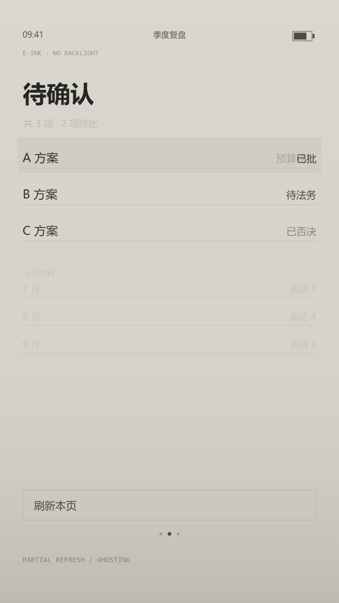

# 案例 08 · 电子墨水屏

**状态：实验（单帧已验证，未出片）。** 没有分镜、没有旁白、没有成片，只验证了一件事：**无背光的灰阶屏能不能一眼认出来。** 实现就在本仓库：`renderer/exp/styles.js` 的 `eink()`。



## 一句话

没有背光的灰阶屏，刷新是局部的，所以**旧内容不会立刻走**——屏幕上永远叠着上一屏的字。

## 视觉构成

| 项 | 值 |
|---|---|
| 底 | `#D5D3CA` 暖灰（不是白）。纯白是背光屏的特征，e-ink 的底永远带一点绿黄 |
| 墨 | `#1B1B18`（不是纯黑）。最高 alpha 0.95，永远达不到 1 |
| 环境光 | 竖向线性渐变：顶部 `rgba(255,255,255,0.10)` → 45% 归零 → 底部 `rgba(60,58,50,0.16)`。**上面那盏灯照下来的**，不是屏幕自己发亮 |
| 残影色 | `#6F6D66`，分三档 alpha：0.36（刚被替换的旧值）/ 0.24（上一屏的说明行）/ 0.12–0.18（整屏残留的旧表格） |
| 刷新区底色 | `#C6C4BA` alpha 0.42×(进度)——刷过的地方残余电荷不一样，底色比别处浅一格 |
| 边框线 | `#B9B7AE` 1.6px；按钮框 1.8px |
| 版式 | 状态栏 y120、标题 76px y326、列表从 y480 起行距 116、按钮 y1560、页码点 y1700、页脚 mono y1790 |
| 时间 | `t > 0.55` 才开始出现残影，0.55–1.0 线性淡入（`k`） |
| 单帧成本 | 63ms（1080×1920，含 PNG 编码）→ 1800 帧约 113 秒 |

## 实现入口

- `renderer/exp/styles.js` 的 `eink(c, p)`，`p` 是局部刷新的进度
- 出图：`scripts/exp-render.mjs --style eink --t 1 --w 720 --out docs/samples/style-08-eink.png`
- 残影全靠三处 alpha：行内旧值、列表上方的说明行、下方整块"上月结转"表格
- 色板导出在 `window.Exp.PAL.EINK`

## 关键技术点

**一、e-ink 像不像，取决于"底色对不对"，不是"灰阶够不够"。** 第一版用 `#D5D3CA` 打底、加了一层中心径向渐变做"环境光"，出来是一团雾——因为径向渐变的中心亮、四周暗，读起来像镜头暗角，不像屏幕。改成竖向线性（上亮下暗）之后立刻对了：**无背光的意思是光从上面来**，屏幕自己不发光，所以越靠下越暗。

**二、残影要能被看见，就必须有一部分没被新内容盖住。** 第一版把旧值"待审批"和新值"预算已批"左对齐放在同一个位置，结果旧值 100% 被新字的笔画覆盖，白画——只有 0.20 的灰从新字的缝隙里透出来，肉眼完全看不见。改成**状态列右对齐**之后才成立：旧值"预算待批"比新值"已批"长，右对齐让左边多出一大截鬼影。**残影的可见性是一个排版问题，不是一个透明度问题。**

**三、残影区必须落在当前内容的空白处。** 第二版把"上月结转"那张旧表格放在 y≈700，正好和当前列表三行叠在一起，看起来像排版撞车，不像残影。挪到 y880–1140 的空白带之后，"上一屏还留着"才读得出来。**残影不是叠加，是残留**——它只能出现在没有新内容的地方。

**四、不要画刷新时的扫描条。** 中间试过在刷新区加 5 条横向拖影（`fillRect`，alpha 0.05），想表达"局部刷新的波形"。出来像故障条的加载动画，是"信号坏了"不是"屏幕慢"。删掉之后只剩底色差 + 旧值残留，反而更像。**e-ink 的慢是安静的，不是抖动的。**

**五、对比度必须压住。** 墨 `#1B1B18` 最高 alpha 0.95，次要信息 0.74、禁用 0.46、残影 0.12–0.36。全套没有一处 alpha 为 1，也没有一处纯白——这是它和普通灰色 UI 唯一的区别。做了这一层之后，同一张图扔进任何"灰度 UI 模板"里都能一眼分出来。

## 已知缺陷

| 缺陷 | 位置 | 说明 |
|---|---|---|
| **刷新过程没有画** | `eink()` 的 `t` | e-ink 局部刷新有 200–400ms 的黑白翻转（先全黑再全白再落字），这是它最像自己的动作。这里只做了"残影淡入"，跳过了翻转，动起来会像"文字渐渐出现"而不是"屏幕在刷" |
| **残影不会衰减** | 三处 alpha | 真实 e-ink 的鬼影会随刷新次数慢慢变淡，但有几处顽固残留永远不走。这里是固定 alpha，`t` 走完就停在那儿 |
| **残影的方向不对** | 行内旧值 | 真实残影是"上一次这一块显示的东西"，位置完全重合。为了能看见，这里靠右对齐让它露出来——**这是取巧**。正确做法是让新内容更短、或者让残影横向错开 1–2px（刷新时的电泳位移），而不是靠排版 |
| **没有物理边框** | 全帧 | 满屏出血，没有设备边框、没有屏幕与外壳的接缝、没有反光。所以它像"一张灰色的图"，而不是"一块屏"。要补得先决定这是"设备特写"还是"屏幕画面" |
| **灰阶只有 5 档** | 色板 | 真 e-ink 常见 16 档灰，这里是 5 个手挑的色值。做渐变或图片时会断成色带 |
| **字体是系统无衬线** | 全文 | e-ink 的字通常带一点点笔画加粗（电泳颗粒扩散）。系统字体渲染太"锐"，放大到特写会露馅 |
| **"上月结转"是硬编码** | 残影表格 | 三行月份与数字写死在数组里，没有"上一屏状态"这个概念。做多镜时会自相矛盾（上一镜的列表和这一镜的残影对不上） |
| 无光标、无翻页动画 | 全帧 | 只有一帧静态。e-ink 的两个招牌动作（刷新翻转、翻页）都没做 |

## 什么场合用

- 题材本身在讲**信息滞后、等待审批、消息还没到、版本还没同步**。残影就是"旧消息还在那儿"。
- 要**冷静、克制、不催促**的气质：清单、待办、归档、公告、值班表、库存。
- 画面要**低对比但可读**：它是全仓库唯一能在满屏浅灰里还保持信息层级的介质。
- 需要表达**"这是最终显示，不是实时"**：电子价签、电子工牌、公告屏、看板。
- 内容以**文字与列表**为主。这套介质天生不适合图形，适合"一行一行的事"。

## 什么场合别用

- **要视觉冲击、要热闹。** 它的全部戏剧性是"淡"，放进信息流里会被划过。要做响的去做 07 的丝网印刷。
- **要动、要快。** 刷新一次 200–400ms，天生慢。做快剪会自相矛盾。
- **要彩色。** 一旦上色，它就变成"灰色 UI 加了个绿点"，不再是 e-ink。
- **要高清特写。** 缺陷表第 6 条：字体太锐，推到 1.5 倍就露馅。
- **要精确的图表。** 5 档灰做不了数据可视化，会断成色带。
- **单纯做"深色模式"。** 这套逻辑的前提是"环境光 + 不发光"，跟深色模式是两件事，混用会两头不像。

## 换个题材怎么改

这套骨架的核心不是"电子墨水屏"，是**"一个不允许你立刻忘掉的界面"**——改过的东西留着影子，屏幕记得上一屏：

1. **先定"上一屏"是什么。** 这一版是"上月结转"的三行表格，因为讲的是季度复盘。换题材时先写清楚：这一屏之前，用户在看什么？**残影必须有出处**，随手撒几个灰字只是脏。
2. **重排状态列，让旧值露出来。** 残影能不能看见，取决于新旧两个值谁更长、怎么对齐。迁移时先列出"被替换的那几个字段"，把旧值写得比新值长，或者改成右对齐/居中，让差值露在边上。
3. **给残影分区。** 三级就够：刚被替换的（0.36）、上一屏的说明（0.24）、整屏遗留的旧结构（0.12–0.18）。**每一级必须落在不同的空白带里**，叠在一起就是撞车。
4. **把 `t` 拆成两个动作。** 现在只有一个淡入。要出片至少要有：翻转（0–0.35，先全黑再全白）+ 落字（0.35–0.7）+ 鬼影浮现（0.7–1.0）。翻转那一下是这套介质唯一的高潮，不能省。
5. **定底色再定所有灰。** 先钉死底色（这一版 `#D5D3CA`），再往上排 alpha 阶梯；反过来做（先选好看的灰再配底）一定会出现"某个灰比底还亮"的错误。

不要动的是：**底色不是白、墨不是黑、没有一处 alpha 为 1、残影只出现在空白处、四周比中心暗**。这五条决定它"像一块屏"而不是"像一张灰色海报"。

## 风格引导块

```
视觉：无背光的电子墨水屏（e-ink），暖灰底、墨非纯黑，改过的内容留着浅灰残影。
底：#D5D3CA（不是白，带一点绿黄）；墨 #1B1B18，最高 alpha 0.95，全程没有 alpha 为 1 的地方。
环境光：竖向线性——顶部 rgba(255,255,255,0.10) → 45% 归零 → 底部 rgba(60,58,50,0.16)。
        光从上面来，越靠下越暗；不许用中心径向渐变（会变成镜头暗角）。
alpha 阶梯：主文 0.95 / 次要 0.78 / 禁用 0.46 / 残影 0.36（刚被替换）、0.24（上一屏说明）、0.12–0.18（整屏遗留）。
刷新区：底色 #C6C4BA alpha 0.42，只覆盖被刷新的那一行（行高 116px）；
        旧值 #5E5C55 alpha 0.36 压在同一基线上，靠右对齐让左边露出一截。
残影分区：整屏遗留的旧表格放在当前内容的空白带（y 880–1140），不许和列表叠。
边框线：#B9B7AE，1.6px；按钮框 1.8px，圆角 0。
版式：状态栏 26px y120、标题 76px y326、列表 38px/32px 行距 116、按钮 34px y1560、页脚 24px mono。
时间：t>0.55 起淡入残影，0.55–1.0 线性。
不要：纯白、纯黑、投影、发光、圆角、彩色、扫描线式的拖影、满屏均匀噪点。
```

配套的五条硬约束：

- **底色不是白，墨不是黑，没有 alpha 为 1 的像素。** 这三条是它与"灰色 UI"的唯一分界。
- **残影只出现在没有新内容的空白处。** 叠在当前内容上就是撞车，不是残留。
- **残影要能被看见，靠排版让位（对齐、长短差），不靠加透明度。**
- **不画扫描条。** e-ink 的慢是安静的。
- 四周比中心暗，上沿比下沿亮——做成径向渐变会变成暗角。

---

**和 01–07 的关系：** 07 让画面里同时存在两份**内容**，这一版让画面里同时存在两个**时刻**。前七版的时间都是"正在发生"，这一版的时间是"已经发生而还没消失"。它不能表达"正在变"，只能表达"变过了，痕迹还在"——这是它唯一能做、别处做不了的事。
