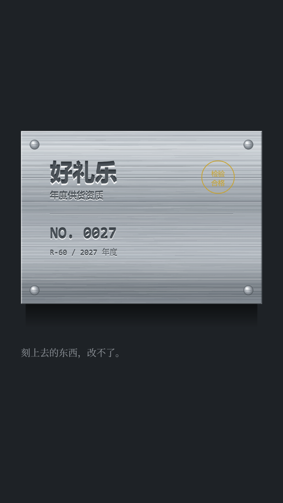

# 案例 09 · 金属铭牌

**状态：实验（单帧已验证，未出片）。** 没有分镜、没有旁白、没有成片。这张卡要如实记一件事：**三种实验里它最弱**，理由写在缺陷表前两条。实现就在本仓库：`renderer/exp/styles.js` 的 `metal()`。



## 一句话

拉丝铝板上的凹刻字，四角铆钉，一枚金色检验章——**刻上去的东西，改不了。**

## 视觉构成

| 项 | 值 |
|---|---|
| 工作台 | `#1E2226` 深灰近黑，无纹理 |
| 牌体 | x 80–1000、y 500–1160（920×660）；竖向六档渐变 `#C6CDD4` → `#DAE0E5`(10%) → `#98A0A8`(42%) → `#C0C7CE`(72%) → `#6B737B`(94%) → `#868E96` |
| 拉丝 | 3200 条水平细线，贯通全宽占 65%、其余长度 40–316px；线宽 0.5–1.3；亮线 `#FFFFFF` alpha 0.03–0.16、暗线 `#3F464D` alpha 0.03–0.14 |
| 深沟 | 9 道横向浅沟，线宽 1.6–3.2，`#3A4148` alpha 0.10–0.20（打破均匀） |
| 倒角 | 上沿与左沿 `#FFFFFF` alpha 0.6 线宽 3；下沿与右沿 `#31373D` alpha 0.55 |
| 铆钉 | 半径 18，四角内缩 52；径向渐变 `#FAFCFD` → `#A9AFB6`(42%) → `#4E555C`，另加一道刻槽 |
| 凹槽底（字） | `#464D54` alpha 0.97 |
| 刻痕明暗 | 上沿 `#22282D` alpha 0.90（背光）、下沿 `#FFFFFF` alpha 0.88（接光），偏移量 = 字号 × 0.075 |
| 检验章 | `#C9A227` 圆环 r62、线宽 3，两行字 26px——全片唯一的暖色 |
| 字号阶梯 | 86 / 58 / 34 / 30 / 36（暖色说明用宋体） |
| 单帧成本 | 81ms（1080×1920，含 PNG 编码）→ 1800 帧约 146 秒 |

## 实现入口

- `renderer/exp/styles.js` 的 `metal(c, p)`，内含 `etchText(text, x, y, size, o)` 负责凹刻
- 出图：`scripts/exp-render.mjs --style metal --w 720 --out docs/samples/style-09-metal.png`
- 画法：`createLinearGradient`（牌体六档）/ 循环 3200 次 `stroke`（拉丝）/ 四段 `stroke`（倒角）/ `createRadialGradient`（铆钉）/ `etchText` 三遍 `fillText`
- 色板导出在 `window.Exp.PAL.METAL`

## 关键技术点

**一、凹刻是"上暗下亮"，写反就是浮雕。** 光从上往下照，字刻进金属后，凹槽**上沿**背光（暗），**下沿**接光（亮）。第一版写成上亮下暗，出来是明显的**凸**字——不是"刻进去的"，是"贴上去的"。这一条错了，整个介质就反了，而且反得很自然，不盯着看不会发现。

**二、拉丝是密度，不是划痕。** 第一版画了 420 条、长 60–420px，出来像被抹布擦过——因为条数太少，每一条都成了"一道痕"。改成 3200 条、多数贯通全宽、线宽 0.5–1.3 之后才成为"拉丝**面**"：**纤维是背景纹理，不是装饰线条。** 再加 9 道更深的横向沟，是为了打破绝对的均匀——完全均匀的拉丝看起来像塑料。

**三、牌体不能是白的。** 中间那版把渐变调到 `#F0F4F7` 起步，出来像塑料板或喷漆钢板——因为铝的反射率没那么高。压到 `#98A0A8` 做中间调、`#6B737B` 做下沿之后，"金属"才成立。**金属感来自中间调的灰，不是来自高光。**

**四、倒角那一圈决定它是"块"还是"贴纸"。** 上左亮、下右暗的四段细线，成本不到十行代码，但没有它，牌体就是一张贴在深色背景上的矩形图片。厚度是画出来的，不是算出来的。

**五、金色检验章是唯一允许的暖色。** 整套色板全是冷灰，一处 `#C9A227` 就把视线钉在"检验合格"上。这个颜色不能多用——第二个暖色出现，它就变成装饰了。

## 已知缺陷

**这张卡最重要的一节：这套介质在竖屏上是有上限的，前两条会直接影响能不能用。**

| 缺陷 | 位置 | 说明 |
|---|---|---|
| **凹刻在手机尺寸上会退化** | `etchText` | 刻痕的明暗差只有字号 ×0.075（86px 字约 6.5px，缩到 540px 宽只剩 3px）。1080 原图上能看出"刻进去"，手机上退回成"深色的字"。要让它在小屏成立，偏移量得加大到 0.12 以上，但那样字会散架。**这是这套介质在 9:16 上最硬的一条限制** |
| **它只做得了一个画面，做不了一支片** | 整个 `metal()` | 铭牌是"最终态"：刻好了，故事就结束了。它没有"过程"可演——不能写、不能改、不能擦。60 秒的片子放在这块牌上，第二镜就该切走了。要撑长度只能靠运镜和光，但拉丝在推镜时又会明显重复 |
| 拉丝是二维图案 | 3200 条 `stroke` | 没有各向异性的高光响应：真实拉丝铝在光源移动时，整片纤维会一起"呼吸"。这里是静态的，镜头一动就露馅 |
| 牌体没有厚度 | 倒角四段线 | 侧边不可见，转一个角度就会穿帮。俯视 90° 时安全，倾斜就不行 |
| 铆钉是贴上去的 | 径向渐变 | 没有投影落在牌面上，也没有把牌面压出凹陷。放大看是"画了一个圆" |
| 检验章压着拉丝 | `#C9A227` 圆环 | 印章的墨应该盖在拉丝之上、带一点渗透。现在是纯色线条叠在纹理上，像 UI 图标 |
| 字体是系统无衬线 | 全文 | 凹刻字通常是专门的机械雕刻字（等宽、笔画等粗、圆角）。用微软雅黑刻出来的效果，更像"深色印刷"而不是"机刻" |
| 无时间与光照变化 | `p` 未使用 | 函数签名收了 `p`，但完全没用。真要出片，第一件事是让光源方向随镜头变，否则它就是一张静止的图片 |
| 缩略图上认得出，全屏反而不像 | 整体 | 540px 时"灰牌子 + 铆钉 + 金章"三个特征够用；1080 全屏看，拉丝的重复和字体的现代感会同时暴露。**它是三种实验里唯一"小图比大图可信"的** |

## 什么场合用

- 题材本身在讲**定论、盖棺、不可撤销**：认证、资质、编号、铭牌、奖牌、出厂标签、合同落章。
- 需要"这一条是最终版"的语气——它天然没有商量余地，适合做片尾、做结论、做"就这一句"。
- 要**冷、硬、有分量**：与 07 的便宜、08 的克制并列，它是三种里唯一"贵"的。
- 画面只有一个信息点。铭牌上放不下第二件事，塞进去就不像铭牌了。
- 用在**短片段**，3–5 秒，一个推镜或一次光扫过即可。

## 什么场合别用

- **要讲故事、要过程。** 缺陷表第二条：它只有终态。要"变化"去做 06 的年度计划表或 08 的电子墨水屏。
- **要长片。** 60 秒靠一块不动的牌子撑不住，第二镜观众就已经读完了。
- **要小屏可读的细节。** 凹刻在手机尺寸上退化（缺陷表第一条）。要是必须用，字号别低于 60px、信息别超过三行。
- **要暖、要有人。** 冷灰 + 拉丝是"没有人的地方"。要人间烟火去做 05 的灯箱。
- **要表现"正在被写"。** 铭牌刻好了就结束，写的过程不属于这个介质。
- **横屏大构图。** 牌体是按 9:16 的 920×660 排的，横向撑开就变成一块巨大的空板。

## 换个题材怎么改

这套骨架的核心不是"金属铭牌"，是**"一个已经定稿、不可修改的物件被光扫过"**。迁移时保的是"终态 + 权威感"，换的是刻在上面的东西：

1. **先确认题材允不允许"没有过程"。** 这一版刻的是供货资质编号，因为它本来就是终态。换成"奖牌""出厂铭牌""设备序列号"都成立；换成"计划""进度""待定"就自相矛盾——**刻上去的东西不能是还没发生的事**。
2. **把信息压到三行以内，并定好层级。** 这一版：主体名（86px）+ 一行说明（34px）+ 编号（58px 等宽）+ 一行年份（30px）。第四行开始，牌子就变成"表格"了。换题材时按"名字 / 属性 / 编号"重排，字号阶梯保持 2.5 倍差。
3. **重算凹刻深度。** 偏移量是字号 ×0.075，且**缩略图能不能看出是凹的**由这个乘积决定。换字号后至少做一次"缩到 540px 看一眼"的检查：看不出凹凸就把字号加大，别加深偏移（加深会让字散架）。
4. **定一处暖色，只定一处。** 这一版是金色检验章。换成奖牌可以是绶带红，换成铭牌可以是唯一一枚铜色螺钉。**第二个暖色出现，权威感就变成了装饰感。**
5. **给 `p` 补一个语义再出片。** 现在是空参数。最小可行的时间轴是：光从左扫到右（0–1，拉丝的亮度随之整体偏移）+ 牌体轻微推近（1.0→1.06）。不要做旋转、不要做翻转——金属一翻转就露厚度。

不要动的是：**凹刻上暗下亮、拉丝是面不是线、牌体中间调不能过白、四边必须有倒角**。这四条决定它"像一块金属"而不是"像一张灰色渐变"。

## 风格引导块

```
视觉：拉丝铝铭牌，深灰工作台上，凹刻字 + 四角铆钉 + 一枚金色检验章。
牌体：920×660，居中偏上；竖向六档渐变 #C6CDD4 → #DAE0E5(10%) → #98A0A8(42%)
      → #C0C7CE(72%) → #6B737B(94%) → #868E96；中间调不许亮过 #A8AEB4（过白就像塑料）。
拉丝：3200 条水平细线，多数贯通全宽，线宽 0.5–1.3px；
      亮线 #FFFFFF alpha 0.03–0.16、暗线 #3F464D alpha 0.03–0.14；另加 9 道深沟打破均匀。
倒角：上沿与左沿 #FFFFFF alpha 0.6 / 3px，下沿与右沿 #31373D alpha 0.55——没有这一圈就是贴纸。
铆钉：半径 18，四角内缩 52，径向 #FAFCFD → #A9AFB6(42%) → #4E555C，附一道刻槽。
凹刻字（关键）：光从上往下照，凹槽上沿背光、下沿接光，所以是「上暗下亮」：
      上沿 #22282D alpha 0.90、下沿 #FFFFFF alpha 0.88，偏移 = 字号 × 0.075，槽底 #464D54 alpha 0.97。
      写成上亮下暗就是浮雕（凸的），整张牌的语义就反了。
字号：主体名 86px / 编号 58px 等宽 / 说明 34px / 年份 30px；四行以上就不像铭牌了。
暖色：只允许一处 —— 检验章 #C9A227 圆环 r62、线宽 3、两行 26px 字。
时间：光从左扫到右 + 牌体推近 1.0→1.06；不旋转、不翻转（一翻就露厚度）。
不要：纯白高光、镜面反射、发光、投影贴纸式的假阴影、圆角、第二处暖色、把铭牌当卡片排版。
```

配套的五条硬约束：

- **凹刻一律上暗下亮。** 写反就是浮雕，而且反得很自然，不盯着看不出来。
- **拉丝是面，不是线。** 条数少于 2000 就会变成"擦痕"。
- **牌体中间调不许过白。** `#A8AEB4` 是上限。
- **暖色只有一处。** 第二处出现，权威感变成装饰感。
- 所有随机量（拉丝长短与明暗）走固定种子，卡面两次渲染必须逐像素相同。

---

**和 01–08 的关系：** 08 让画面里有两个时刻，09 让画面里**只有一个时刻，并且它已经被固定住了**。前八版都还能"改"——纸能擦、屏能刷、字能重写；这一版不能。它唯一能做的是**把"不可撤销"画出来**，代价是它撑不了一支片，只能撑一个结论。三张新卡里它最弱，也最诚实：**它是一次失败的"能不能做成长片"的试探，留下来的价值是那条"凹刻在手机尺寸上会退化"的实测。**
